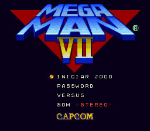
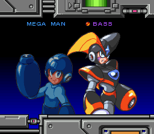
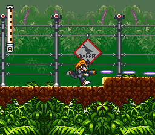
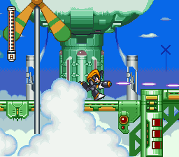
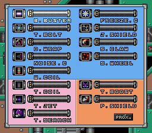
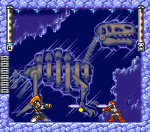

# Mega Man 7 EX Edition

Patch para **Mega Man 7** (Super Nintendo) que torna o **Bass** jogável numa campanha própria,
com a história invertida, e mantém a campanha original do Mega Man inteira. O jogo pode ser
jogado em **português (BR)** ou em **inglês** (escolha ao ligar).

Hack feita por **Repliroid do Futuro (Gabriel Calmon)**.

 
 
 

## Download

- [Mega Man 7 EX Edition.bps](https://github.com/VrepliroidV/Megaman7-EX-Edition/raw/main/Mega%20Man%207%20EX%20Edition.bps) (recomendado, 410 KB)
- [Mega Man 7 EX Edition.ips](https://github.com/VrepliroidV/Megaman7-EX-Edition/raw/main/Mega%20Man%207%20EX%20Edition.ips) (4,7 MB)
- [LEIAME - Mega Man 7 EX Edition.txt](https://github.com/VrepliroidV/Megaman7-EX-Edition/raw/main/LEIAME%20-%20Mega%20Man%207%20EX%20Edition.txt)

Os dois patches dão a mesma ROM; use só um deles.

## Como aplicar

| | |
|---|---|
| ROM necessária | Mega Man 7 (USA), original, sem header, 2 MB |
| CRC32 da ROM original | `2D947536` |
| CRC32 depois do patch | `EBD6A561` (a ROM fica com 6 MB) |

1. Baixe o patch `Mega Man 7 EX Edition.bps` (recomendado) ou o `Mega Man 7 EX Edition.ips`.
2. Aplique na ROM original com um programa de patch, como o Floating IPS (Flips), o beat ou o
   ROM Patcher JS (no navegador).
3. Use sempre a ROM original sem modificações, nunca uma que já recebeu uma versão anterior do
   patch.

A ROM não está incluída neste repositório.

## Termos de uso

- Esta hack é distribuída para uso pessoal, como patch BPS / IPS.
- **Não é permitido modificá-la**, distribuir versões alteradas nem reaproveitar o conteúdo dela
  (código, gráficos, sons, telas, textos) em outros projetos **sem permissão** do autor,
  Repliroid do Futuro.
- **Não é permitido vender**, de nenhuma forma (ROMs, cartuchos repro, coletâneas).
- Para divulgar, compartilhe o link desta página em vez de reenviar o patch.
- Quer fazer algo baseado nela? Peça permissão antes.

## O que tem

- **Escolha de idioma** ao ligar o jogo: English ou Português (BR). Em inglês, todos os textos
  das duas campanhas são uma tradução nova, feita a partir do português deste patch.
- **Seleção de personagem** depois de INICIAR JOGO / PASSWORD, no estilo da tela de weapon get,
  com as imagens do Mega Man & Bass.
- **Campanha do Mega Man**: o Mega Man 7 original, como era.
- **Campanha do Bass**: a história invertida, com Bass e Treble no lugar de Mega Man e Rush (e
  vice-versa) e diálogos reescritos. O Bass tem tiros, dash, armas com cores próprias, fusão
  com o Treble (T.Boost), T.Coil, T.Jet e T.Search, placas T.R.E.B.L.E., novas cenas, lutas
  contra o Mega Man na torre do Wily e um final próprio.
- **Loja do Reggae** no lugar da loja do Auto, com cenário no estilo do laboratório do Wily.
- **Modo Versus** no menu do título, com as arenas das salas dos chefes e o Proto Man como
  terceiro lutador.

A lista completa e detalhada de mudanças está no
[LEIAME - Mega Man 7 EX Edition.txt](LEIAME%20-%20Mega%20Man%207%20EX%20Edition.txt).

## Créditos

- Hack: Repliroid do Futuro (Gabriel Calmon).
- Sprites extras: ChaoticPrince7 ("Bass MM7 Expansion Sprites Sheet", Sprites INC), ACE_Spark
  (quadros não usados do Bass), Grim (sprites do Rockman & Forte, spritedatabase.net),
  AndrewHagArtist (Bass andando no final; agradecimento especial a hansungkee), BarylTDF
  ("Reggae (MM7 style)", domínio público) e Solink (folha do Proto Man de Mega Man 2: The Power
  Fighters).
- Mega Man 7, Mega Man & Bass e todos os personagens pertencem à Capcom. Este é um projeto de
  fã, gratuito e sem fins lucrativos.

Os créditos completos estão no LEIAME.

## Terms of use (English)

- This hack is shared for personal use, as a BPS / IPS patch.
- **Do not modify it**, redistribute modified versions or reuse its content (code, graphics,
  sounds, screens, texts) in other projects **without permission** from the author, Repliroid do
  Futuro.
- **Do not sell it** in any form (ROMs, repro carts, bundles).
- To share it, please link to this page instead of re-uploading the patch.
- Want to make something based on it? Ask first.
